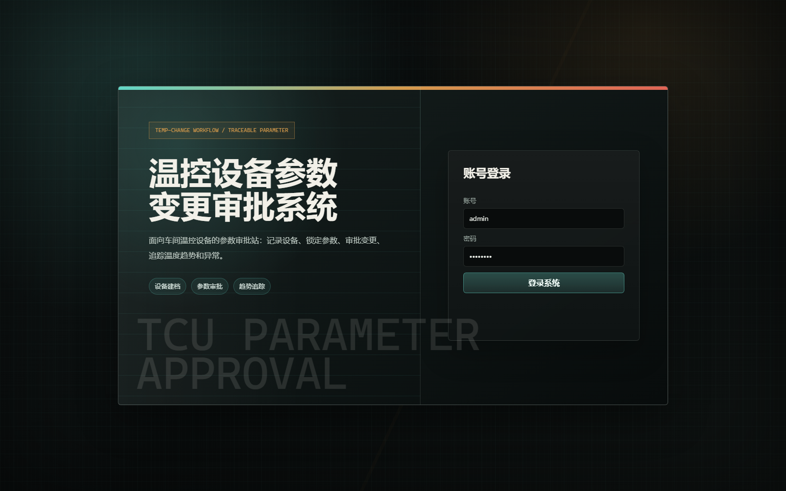
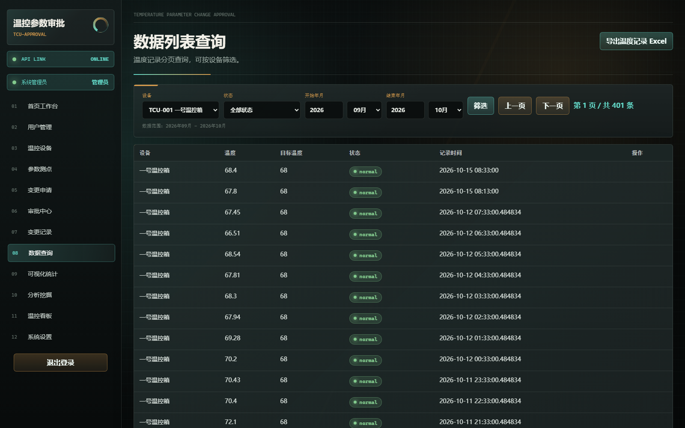
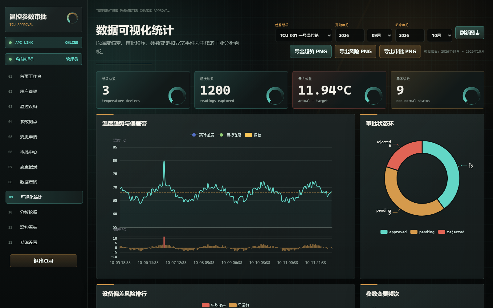
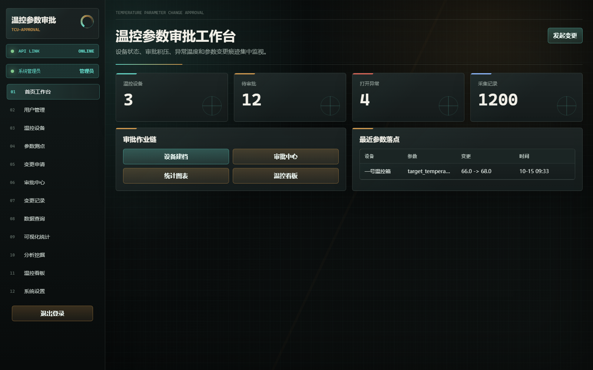

# 温控设备参数变更审批系统

> **English**: A full-stack temperature-control equipment parameter-change approval system — FastAPI + SQLite backend, native HTML/CSS/JS frontend with Axios + ECharts, plus Pandas/Matplotlib data analysis. Built as a Python data-analysis course project by 张轩茂.

作者：张轩茂（Python 数据分析与挖掘课程项目）。

## 界面截图（Screenshots）

| 登录页 | 数据查询 |
| --- | --- |
|  |  |

| 可视化统计 | 数据看板 |
| --- | --- |
|  |  |

## 项目简介

本系统围绕“温控设备参数变更审批系统”完成业务闭环：

设备建档 -> 参数/测点维护 -> 参数变更申请 -> 管理员审批 -> 变更记录追溯 -> 温度趋势与异常分析。

工业水泵 HMI 项目只作为功能参考：本项目借鉴状态看板、趋势曲线、报警列表和历史日志，不加入水泵启停、阀门、Modbus、PLC 或 Qt 桌面端功能。

## 技术栈

- 后端：Python + FastAPI
- 数据库：SQLite
- 前端：HTML + CSS + JavaScript + Axios + ECharts
- 数据分析：Pandas + Matplotlib + Jupyter Notebook

## 目录结构

```text
backend/          FastAPI 接口代码
database/         schema.sql、data.sql、SQLite 数据库
frontend/         10+ 个 HTML 页面和静态资源
scripts/          批量造数脚本
analysis/         数据分析 Notebook
docs/             报告、PPT 提纲与导出样例
tests/            pytest 验证用例（16 个）
```

## 启动方式

服务要求设置认证密钥环境变量 `TEMPERATURE_AUTH_SECRET`（至少 16 位随机字符串，代码不提供默认值）：

```bash
# PowerShell 生成本次会话的随机密钥
$env:TEMPERATURE_AUTH_SECRET = python -c "import secrets; print(secrets.token_hex(32))"

pip install -r requirements.txt
python scripts/seed_data.py
python -m uvicorn backend.main:app --host 127.0.0.1 --port 8008 --reload
```

也可以在 Windows 上双击：

```text
start_api.bat
```

`start_api.bat` 在未设置密钥时会自动生成一个仅限本机演示的随机密钥。

可选环境变量：

| 变量 | 默认 | 说明 |
| --- | --- | --- |
| `TEMPERATURE_AUTH_SECRET` | 无（必填） | 登录令牌签名密钥，缺失或过短时服务拒绝启动 |
| `TEMPERATURE_TOKEN_TTL_SECONDS` | `7200` | 登录令牌有效期（秒），过期后需重新登录 |
| `TEMPERATURE_DB_PATH` | `database/temperature.db` | SQLite 数据库路径 |

打开系统：

```text
http://127.0.0.1:8008/frontend/login.html
```

接口文档：

```text
http://127.0.0.1:8008/docs
```

## 演示账号

- 管理员：admin / admin123
- 普通用户：user1 / 123456

演示口令在数据库中以 PBKDF2-HMAC-SHA256 加盐哈希存储，仅用于本地演示，请勿用于真实环境。

### 角色区别

- 管理员：用户管理、设备与测点维护、Excel 导入、温度录入、审批中心，以及全部查询分析功能。
- 普通用户：查看工作台和分析页面、提交本人参数变更申请、查看本人申请进度及历史变更。
- 登录后前端会按角色显示菜单；后端同时校验签名令牌有效期与角色权限，直接调用管理员接口也会被拒绝。

## 页面清单

1. 登录页
2. 首页工作台
3. 用户管理
4. 温控设备管理
5. 参数/测点管理
6. 参数变更申请
7. 审批中心
8. 变更记录
9. 数据列表查询
10. 数据可视化统计
11. 数据分析与挖掘
12. 温控状态看板
13. 系统设置

## 验证命令

```bash
python -m pytest tests -q
python scripts/seed_data.py
```

## 项目规模与亮点

- 后端 `backend/main.py` 1300+ 行，提供 36 个 REST 接口，覆盖认证、RBAC、设备/测点 CRUD、变更申请、审批、变更记录、温度读数、报警、统计分析、Excel 导入导出等模块。
- 前端 13 个页面（登录、工作台、用户管理、设备、测点、变更申请、审批中心、变更记录、数据查询、可视化统计、分析挖掘、温控看板、系统设置），Axios + ECharts。
- 审批闭环：变更申请提交后必须经管理员审批，通过后自动生成审批记录与变更日志，并同步更新设备参数；全部业务表软删除（`deleted_at`），保证记录可追溯。
- 安全加固：口令 PBKDF2 加盐哈希存储、签名密钥仅从环境变量读取（无默认值）、登录令牌带有效期、审批事务 `BEGIN IMMEDIATE` 串行化。
- 审批校验：审批时复核申请原值与设备当前值一致（不一致返回 409）、新值必须为有限数字且落在设备安全区间内（越界返回 400），重复审批返回 400。
- 数据分析：`analysis/temperature_analysis.ipynb` 用 Pandas/Matplotlib 完成数据质量检查、描述性统计、阈值异常检测（绝对偏差 ≥ 6℃）、审批与报警统计、移动平均趋势分析。
- 趋势预测：`/api/analytics/insights` 与 Notebook 逻辑一致，按设备分组计算最近 12 条读数移动平均，避免不同目标温度设备的读数混算。
- 测试：`tests/` 16 个 pytest 用例，覆盖数据库 schema、登录与审批流程、前端页面、分析产物、导出入口，以及口令哈希、令牌过期与篡改、审批并发、越界输入、权限边界和按设备预测。
- 造数：`scripts/seed_data.py` 生成 1000+ 条温度读数等演示数据，可复现。
- 代码规模：Python 约 4,200 行 + JavaScript 约 820 行。
